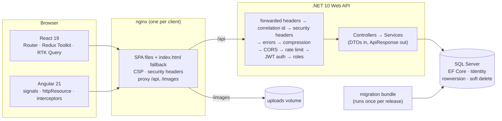

# Architecture, the 2-minute pitch and the 5-minute walkthrough

## Draw this from memory

Practise drawing it in five boxes: **two clients → proxy → API → database**, then add the migration step and the images volume. Name one responsibility per box.

## The 2-minute pitch

> "RedStarVibe is a food-ordering shop that I built three times on the front end, in **React** and **Angular**, both on one **.NET 10** API with **SQL Server**.
>
> Customers browse a paged, filterable catalogue (the filters live in the URL), keep a cart that survives reloads, check out, and rate completed orders. Admins manage products with image upload, and move orders through a status flow.
>
> Security is enforced on the **server**: ASP.NET Identity for passwords and lockout, short-lived signed JWTs, rotating refresh tokens with reuse detection, role-based authorization, and per-user data filtering. The client guards are just UX.
>
> On the data side: EF Core migrations, no N+1 (tests count the SQL), optimistic concurrency with rowversion → 409, soft delete, and snapshot pricing on orders.
>
> It's production-shaped: Docker with a migration bundle, nginx serving each SPA on the same origin as the API, health checks, security headers, CI on every push, and about **490 tests** across the three stacks, including one end-to-end test that runs the whole shop from sign-up to rating."

Time yourself. If it runs over 2 minutes, cut details, not structure.

## The 5-minute walkthrough (the Phase 16 checkpoint)

Follow **one user journey**. Each step: *what happens → where in the code → what could go wrong → how it's prevented.*

**0:00 to 0:30 · Shape.** Two SPAs, one API, one database, behind nginx. Why build it twice: to show I understand the concepts, not one framework's API (state, effects and DI map across both).

**0:30 to 1:15 · Sign up and log in.**
`RegisterPage` → `POST /api/auth/register` → Identity hashes the password → the response is an access token (15 min) and a refresh token (random, **stored only as a hash**). The client keeps the session in localStorage; the trade-off is XSS, mitigated by short tokens, rotation and a strict CSP. Interceptors add `Authorization` and a correlation id to every request. *Risk:* password guessing → lockout + rate limit (429).

**1:15 to 2:00 · Browse.**
`/products?category=pizza&q=…&page=2`: the URL is the state. RTK Query / `httpResource` caches per argument and prefetches the next page. The API pages in SQL with a stable order, projects to DTOs, and runs no N+1 (`ProductList_IsTwoQueries…`). Responses are compressed.

**2:00 to 2:45 · Cart and checkout.**
The cart is a Redux slice / signal store, persisted, and reset on logout. Checkout sends **only ids + quantities**. The server prices everything from the database, merges lines, rejects unavailable products, snapshots name + price, and saves header + lines in one transaction. *Risk:* tampered prices or over-posting → ignored by design (`Place_IgnoresEverythingButIdsAndQuantities…`).

**2:45 to 3:30 · Admin.**
The admin area is lazy-loaded and guarded in the UI; the real protection is `[Authorize(Roles="Admin")]`. Product create/edit runs in an accessible modal; the image upload is multipart with the real file bytes checked. Edits send back the `rowVersion` they loaded, so a concurrent edit → **409** → toast and refetch. Order status moves only along `allowedNextStatuses` from the server.

**3:30 to 4:15 · Back to the customer.**
Once the order is Completed, the customer rates it (1–5, own lines only). "My orders" is filtered by the user id from the token, so another user's id in the URL returns nothing. Token expiry is invisible: one refresh, shared by parallel requests, then retry. Reuse of an old refresh token revokes everything.

**4:15 to 5:00 · Running it for real.**
`docker compose up`: SQL Server → migration bundle (once) → API (non-root, unpublished port) → nginx (SPA fallback, CSP, proxy). Config fails fast at startup. `/health/live` vs `/health/ready`. CI runs every suite against a real SQL Server, audits dependencies and builds the images. Close with the lesson you'd tell a teammate: *"the tests once deleted my dev database through an eager config read. Now config is lazy, the test DB name is guarded, and a regression test holds the line."*

### Self-check after each run
- [ ] Did I name **where security is enforced** (server) at least twice?
- [ ] Did I give at least **two trade-offs** (token storage, OFFSET vs keyset, caching vs freshness)?
- [ ] Did I mention **one bug I found and how a test now prevents it**?
- [ ] Did I stay within **5 minutes**?
